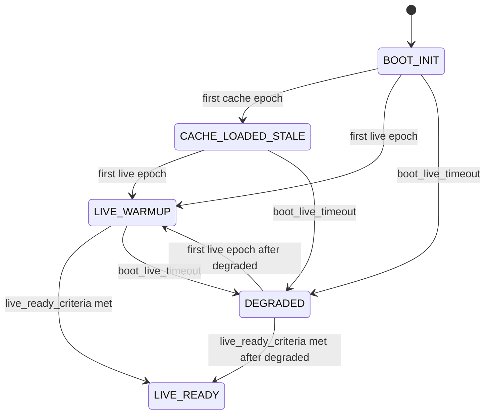

# Semantic Startup FSM

This page documents the startup behavior for semantic data publication in `helianthus-ebusgateway`.

Goal: publish deterministic semantic data during startup without pretending cached values are live.

Vocabulary: on this page a plane, or MCP semantic plane, is a gateway data
family, the payload of one `ebus_v1_semantic_*` tool such as `zones` or `dhw`.
It is not a plane, a lens or a target projection of the
[common semantic contract](https://github.com/Project-Helianthus/helianthus-docs-semantic/blob/main/api/v1/graph.md),
and no tool or field name changes.

## State Machine

## Transition Table

| From | To | Trigger | Notes |
| --- | --- | --- | --- |
| `BOOT_INIT` | `CACHE_LOADED_STALE` | first cache snapshot applied | cache is exposed as stale bootstrap data |
| `BOOT_INIT` | `LIVE_WARMUP` | first live semantic update | first confirmed live signal |
| `CACHE_LOADED_STALE` | `LIVE_WARMUP` | first live semantic update | stale cache begins replacement by live stream |
| `LIVE_WARMUP` | `LIVE_READY` | `live_ready_criteria` satisfied | caller evaluates the readiness predicate after the first live update; see [Live readiness](#live-readiness) |
| `BOOT_INIT`/`CACHE_LOADED_STALE`/`LIVE_WARMUP` | `DEGRADED` | `boot_live_timeout` elapsed | startup did not reach live-ready in time |
| `DEGRADED` | `LIVE_WARMUP` | first live semantic update after degraded | recovery started |
| `DEGRADED` | `LIVE_READY` | `live_ready_criteria` satisfied after degraded | same stream-aware readiness criteria used during normal startup |

## Epoch Semantics

- `cache_epoch` increments when cache-backed semantic payload is applied.
- `live_epoch` increments when a live semantic update is recorded.
- `cache_epoch` and `live_epoch` are tracked independently.
- `live_epoch` is authoritative for startup readiness:
  - `live_epoch = 0`: no live signal yet.
  - `live_epoch = 1`: warmup only.
  - `live_epoch >= 2`: candidate for live-ready; stream criteria still apply.
### Live readiness

**Hypothesis — candidate readiness contract.** Provenance is not published. The readiness predicate checks these domain pairs:

| Domain | Published flag | Live observation flag |
| --- | --- | --- |
| Zones | `zonePublished` | `zoneLiveSeen` |
| DHW | `dhwPublished` | `dhwLiveSeen` |
| Boiler status | `boilerPublished` | `boilerLiveSeen` |
| Circuits | `circuitPublished` | `circuitLiveSeen` |
| Radio devices | `radioPublished` | `radioLiveSeen` |

For each pair, a published domain without a live observation makes the predicate false. The predicate also requires at least one of the five live observation flags, regardless of publication. System and energy are not part of this predicate; energy-only updates do not satisfy it.

The caller `recordEpochUpdateLocked` increments `liveEpoch` on a live update and returns `LIVE_WARMUP` on the first one. On subsequent live updates it evaluates the predicate and transitions to `LIVE_READY` if it succeeds. The epoch threshold belongs to the caller, not the predicate. This candidate describes runtime behavior; actual device readiness remains **Unknown** without qualification. The documentation check enforces agreement between the readiness descriptions; it does not establish implementation conformance.

### Source classification notes

- Persistent semantic snapshot preload (`semantic_cache.json`) is cache-backed and only advances `cache_epoch`.
- In `ebusd-tcp` fallback mode, successful `grab result all` hydration for zones/DHW is classified as **live** and can advance `live_epoch`.
- Energy broadcast ingestion updates `energy_totals` but does **not** advance startup `live_epoch` and does not trigger startup phase transitions.
- `energy_totals` is null until the energy merge store has accepted its first
  point. Energy is not persisted, so after every gateway restart the plane is
  null until the first accepted energy point (see
  [`energy-merge.md`](./energy-merge.md#null-before-the-first-accepted-point)).

## M4 L1 Startup Priming

After B524 semantic root discovery succeeds, the gateway runs a bounded startup
priming pass before the normal periodic semantic loop. The purpose is L1 plane
availability: every MCP semantic plane required by the M4 O1 gate must publish a
non-null payload within 60 seconds of add-on startup when live bus access is
working.

Startup priming is a publication-ordering rule, not a transport or protocol
arbitration change. It does not change `bus.Send`, the adaptermux first-byte
arbitration behavior, or the Direction C F-NEW-29 predicate documented in
[`adaptermux/first-byte-arbitration-revalidation.md`](./adaptermux/first-byte-arbitration-revalidation.md).

The priming pass is intentionally bounded:

- run only after a B524-capable semantic root has been found;
- use short per-probe timeouts so a slow register family cannot monopolize the
  startup window;
- release source-selection semantic bootstrap as soon as active source evidence
  exists; physical identity confirmation and full-range recovery must not hold
  the semantic L1 barrier open;
- retry the DHW singleton path before the startup zone sweep so a transient
  first DHW miss cannot leave the `dhw` plane null while the heavier structural
  scan runs;
- publish lightweight structural or skeleton payloads for planes whose full
  detail is filled by later periodic pollers;
- seed radio-device availability from already-known regulator/FM5 registry
  evidence when remote slot scans have not completed yet;
- allow the first coherent zone-discovery result to publish zones during
  startup, then return zone lifecycle control to the normal presence hysteresis
  FSM.

Physical device identity enrichment is not part of the L1 semantic gate. Serial
number retry/enrichment may refine registry identity after startup, but it must
not consume the first 60 seconds needed to publish the required MCP semantic
planes. The L1 gate requires non-null publication for zones, circuits, DHW,
radio devices, FM5 mode, solar, cylinders, schedules, energy totals, system,
adapter info, and boiler status.

The normal steady-state pollers remain authoritative for complete values,
freshness, removal, and downgrade behavior. For example, schedules may become
non-null during startup before the heavier schedule read cycle fills detailed
entries, and FM5-related planes may publish a bounded startup interpretation
before later system/radio/solar/cylinder reads refine or downgrade the model.

## Steady-State Poll Scheduling

The Vaillant semantic poller uses a single serialized task scheduler for active
semantic reads. Each recurring task family has a stable scheduler key:
regulator capability, discovery, config, state, circuits, system, radio
devices, energy, schedules, and the three boiler-status tiers.

The scheduler MUST coalesce duplicate queued or running tasks with the same key.
If a new tick arrives while the same task family is pending, the queued task is
kept once and its priority may be raised. If the same task family is already
running, at most one deferred rerun is kept for the next available task slot and
additional same-key signals merge into that rerun. This is a load-shaping rule:
it prevents bus contention or slow responders from creating an unbounded backlog
of identical B524/B509 sweeps while preserving edge-triggered refresh signals.

Coalescing does not change any eBUS wire format, `bus.Send` behavior,
adaptermux arbitration, retry classification, or semantic merge semantics. The
next successful execution of a task family remains authoritative for live values;
partial results are still merged according to the incremental freshness rules
below.

Broad B524 backfill tasks must also avoid repeating full topology sweeps when a
stable live inventory already exists. Circuit refresh is the reference pattern:
startup and periodic rediscovery may scan the full documented circuit instance
range, but normal steady-state refreshes operate on the known active circuit
instances until the rediscovery interval expires. This preserves detection of
new or removed circuits without making every config refresh pay the full
`GG=0x02` scan cost. The long rediscovery interval starts only after the full
documented range has produced definitive active/inactive answers; partial scans
retry on the regular configuration cadence. Critical state and boiler fast-tier
reads are not delayed by this backfill pacing rule.

Steady-state zone and DHW polling is split by freshness class:

- The 60-second state task is reserved for live-critical values: zone current
  temperature, target temperature, humidity, operating mode, special function,
  valve/HVAC action, and DHW current/target temperature plus DHW mode fields.
- Slow or rarely changing selectors run on the config cadence: zone quick-veto
  expiry/details, holiday windows, room-temperature-zone mapping, per-zone
  associated circuit type, and DHW holiday dates.
- The boiler fast tier may project DHW fields from the already-refreshed DHW
  semantic snapshot; it must not duplicate the DHW B524 state reads just to
  populate the boiler-status view.

This split bounds gateway-originated `0x7F -> 0x15` B524 traffic after startup
without weakening the L1 startup gate. Startup-specific priming paths may still
perform direct reads for the planes needed to become non-null within 60 seconds.

Steady-state B524 semantic reads are also classified by watch freshness profile.
This is a scheduler max-age and passive-shadow policy, not a new wire protocol:
the semantic task may still ask for a field, but the scheduler can serve a
fresh cached/shadow value instead of issuing a new active `B5 24` request.

- `state_fast`: live-critical state such as zone current temperature, zone
  special function, zone valve/HVAC state, DHW current temperature, DHW special
  function, and equivalent fast circuit/solar live values.
- `state_slow`: slower live telemetry such as humidity, quick-veto expiry,
  operating counters, remote-slot connected/liveness state, remote-slot
  reception/paired state, and remote room telemetry.
- `config`: user or system configuration such as zone/DHW target temperature,
  operating mode, manual fallback temperature, holiday windows, quick-veto
  configuration, room-temperature-zone mapping, and associated circuit type.
  Passive direct apply for this class remains `config_opt_in`.
- `discovery`: structural or identity selectors such as zone names, zone index,
  remote device-slot identity, and device-slot topology. These selectors are
  not `state_default` direct-apply eligible.

Disconnected functional-module inventory slots are identity-only during
steady-state detail refresh. If `device_connected=false` but class/firmware or
hardware evidence proves the slot represents a real FM, the gateway keeps the
inventory snapshot and skips volatile detail reads such as paired state,
reception, zone assignment, room temperature, and humidity until the slot is
connected. This bounds request bursts against empty FM detail registers while
preserving physical topology evidence.

The startup L1 semantic priming path is not weakened by this pacing: startup may
still perform bounded direct reads needed to publish the required MCP semantic
planes non-null within the startup gate.

### Scheduling Without a System Controller

**Proven — merged gateway behavior.** Cadence, suspension conditions and log
marker below are taken from the merged gateway change and its run sheet; the
behavior on a physical installation without a controller is **Unknown** beyond
that run sheet.

On a bus with a heat source and no system controller, no B524 root is found and
the state and configuration tasks run a fallback B524 root discovery pass on
their ticks. Once the regulator absence state (`semantic_regulator_state`, see
[`observability.md`](./observability.md#regulator-state)) is `ABSENT` and this
gateway process has never discovered a B524 root, the state and configuration
tasks no longer run that fallback pass. Root discovery then runs only from the
discovery task at the configured discovery interval (10 minutes by default) and
from event-driven refreshes: a registry inventory change seen by the regulator
recheck, passive address insertion and passive promotion. The suspension logs
`semantic_discovery_fallback_suspended regulator_state=ABSENT
discovery_interval=<interval>` once each time it starts.

- With the periodic discovery task disabled (a discovery interval of zero or
  less) nothing is suspended and the per-minute search stays.
- While suspended, the state and configuration ticks still read the
  boiler-class heat source from the registry, so a heat source identified after
  `ABSENT` gets its status reads on the next tick. The FM5 interpretation is
  still refreshed by the energy task.
- `ABSENT` alone does not mean that there is no controller: a controller
  registered without a serial, with a part number missing from the product
  data, or with the product data unavailable also reaches it. A process that
  has discovered a root once therefore keeps the per-minute recovery after a
  failed discovery pass. Before `ABSENT`, with a known controller, and with a
  known controller that has no zone, the per-minute rediscovery is unchanged.
- A controller that becomes reachable after `ABSENT` on a bus that never had
  one, without passive observation or a registry change, is found within one
  discovery interval instead of one minute. The same applies in a gateway
  process that has not discovered a root yet, for example after a restart
  while a controller that the product data does not classify is still
  unreachable when the absence state is reached.

No configuration switch is added.

## Incremental Merge and Freshness Semantics

Zone and DHW updates are merged incrementally, not replaced wholesale.

- Merge is field-granular for zone config/state and DHW state/config slices.
- For each polling slice, only attempted fields participate in merge decisions.
- Attempted fields with valid values overwrite previous values and are marked fresh.
- Attempted fields without valid values keep last-known values and are marked stale.
- Unattempted fields are left unchanged (no implicit stale transition).

Operational consequences:

- Partial read failures do not wipe previously valid semantic values.
- Empty/nil partial snapshots do not remove zone or DHW entities by themselves.
- Zone visibility/removal remains controlled by zone presence hysteresis FSM.
- DHW is durable under transient cache-only cycles and expires after `-semantic-dhw-stale-ttl`.
- Startup phase progression remains driven by stream-level live/cache epochs.

Implementation note:

- Field freshness is currently tracked in runtime semantic state and used for merge/lifecycle decisions.
- GraphQL currently exposes the merged semantic values; field-level stale flags are not yet separately exposed as API fields.

## Persistent Cache Schema

- Runtime cache file path is configurable via `-semantic-cache-path` (default `./semantic_cache.json`).
- Current schema is **v2**:
  - top-level `schema_version: 2`
  - `metadata.persisted_at`
  - semantic payload: `zones[]` and optional `dhw`
- Legacy **v1** cache payloads (no `schema_version`) are migrated on load:
  - load as v1, convert to v2, rewrite atomically, continue startup using migrated data.
- Unknown schema versions are rejected as invalid cache (runtime continues without preload).

## Timeout Semantics

- Runtime bootstrap timeout is controlled by `-boot-live-timeout` (default `2m`).
- If timeout elapses before live-ready, runtime transitions to `DEGRADED`.
- `DEGRADED` does not block recovery; later live updates can still move runtime to warmup/live-ready.

### Startup Reason Without a Supported Heat-Source Data Path

**Proven — merged gateway behavior.** The reason, its evaluation and clearing
and the timeout log line are taken from the merged gateway change.

The startup block of the bus observability summary carries an additive
`reason` next to the phase (GraphQL `bus_summary.status.startup.reason`, MCP
`ebus_v1_bus_summary_get` `status.startup.reason`). Its only value is
`no_supported_heat_source_path`. It is set while the semantic poller has no
supported heat-source data path: no B524 root and no boiler-class heat source,
while the inventory holds a heat-pump-class identity (a heat-pump device-ID
family `EHP`, `HMU`, `VWL`, `VWS` or `VWZ`, or a Vaillant serial whose part
number the product catalog lists with role Heat Pump).

- The poller evaluates the reason after every discovery pass and on the
  registry-only heat-source refresh of the state and configuration ticks. It
  clears the reason as soon as a root or a boiler-class heat source exists.
- The reason stays clear when the process has discovered a root before or the
  product catalog classifies an inventory identity as a controller, because a
  missing root is then a failing read.
- A heat source of unknown class (neither family nor catalog role) sets no
  reason.
- Otherwise GraphQL returns `reason` as null and MCP omits it.

The phase vocabulary, the readiness predicate, the boot-live timeout and its
default are unchanged. Without live data the phase does not reach
`LIVE_READY`, and the boot-live timer still moves it to `DEGRADED`. With the
reason set, that transition logs `reason="boot_live_timeout elapsed=<timeout>
startup_reason=no_supported_heat_source_path"`, so a bus with nothing the
gateway can read is distinguishable from failing reads. Root discovery is
unchanged: a heat-pump-class unit that answers the root probe coherently is
still adopted as semantic root, and the reason is then clear. No heat-pump
register is read and no heat-pump value is published. Setting and clearing log
markers are listed in [`observability.md`](./observability.md#semantic-lifecycle).

## API and Runtime Cross-Links

- GraphQL runtime notes: [`api/graphql.md`](../api/graphql.md#semantic-startup-runtime-contract)
- Runtime and wiring context: [`architecture/overview.md`](./overview.md#semantic-startup-runtime)
- Semantic read breaker behavior for B524 polling: [`architecture/semantic-read-circuit-breaker.md`](./semantic-read-circuit-breaker.md)
- Zone presence hysteresis state machine: [`architecture/zone-presence-fsm.md`](./zone-presence-fsm.md)
- DHW durability and expiry lifecycle: [`architecture/dhw-freshness-fsm.md`](./dhw-freshness-fsm.md)
- B524 semantic root discovery: [`architecture/b524-semantic-root-discovery.md`](./b524-semantic-root-discovery.md)
- Regulator identity enrichment: [`architecture/regulator-identity-enrichment.md`](./regulator-identity-enrichment.md)
- HA consumer behavior: [`development/ha-integration.md`](../development/ha-integration.md)
