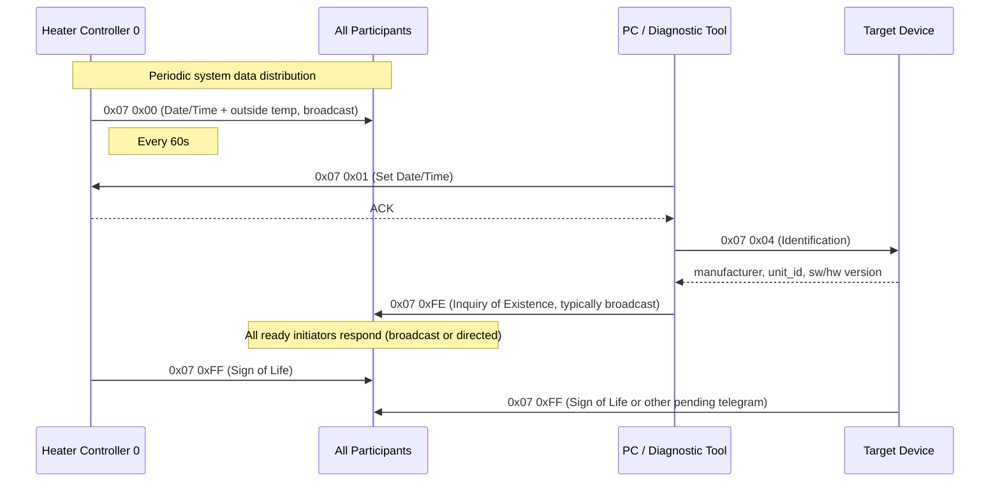

# eBUS Service 0x07 — System Data (Application Layer)

> Source: eBUS Specification Application Layer (OSI 7) V1.6.1, §3.3

## Scope

Service `0x07` manages system-wide data distribution and device discovery. Heater controller 0 periodically broadcasts date/time and outside temperature. Other commands support time setting, device identification, capability queries, and existence probing.

Several commands in this service are also documented (from the implementation perspective) in [`ebus-overview.md`](./ebus-overview.md) — specifically the Identification Scan (`0x07 0x04`) and QueryExistence (`0x07 0xFE`). This document provides the normative specification view.

## Terminology

<!-- legacy-role-mapping:begin -->
> Legacy role mapping (for cross-referencing older materials): `master` → `initiator`, `slave` → `target`.
<!-- legacy-role-mapping:end -->

## Command Summary

| PB | SB | Name | Direction | Telegram Type | Cycle Rate |
|---:|---:|---|---|---|---|
| `0x07` | `0x00` | Date/Time Broadcast | Controller 0 → all | Broadcast | 1/60s |
| `0x07` | `0x01` | Set Date/Time | PC/clock → controller | Initiator/Target | One-time |
| `0x07` | `0x02` | Set Outside Temperature | Service tool → controller | Initiator/Target | One-time |
| `0x07` | `0x03` | Query Supported Commands | Any → target | Initiator/Target | One-time |
| `0x07` | `0x04` | Identification | Any → target or broadcast | Initiator/Target or Broadcast | One-time |
| `0x07` | `0x05` | Query Supported Commands (extended) | Any → target | Initiator/Target | One-time |
| `0x07` | `0xFE` | Inquiry of Existence | Any → all | Broadcast (typically) | One-time (infrequent) |
| `0x07` | `0xFF` | Sign of Life | Any → all | Broadcast (typically) | One-time (response to 0xFE) |

## Commands

### Service 0x07 0x00 — Date/Time Broadcast

**Description:** Periodically broadcast by heater controller 0. Distributes current date, time, and outside temperature to all bus participants.

**Payload (initiator telegram, broadcast, `NN=0x09`):**

| Byte | Field | Type | Range | Description |
|---:|---|---|---|---|
| 0–1 | outside_temp | DATA2b | -50.0 to +50.0 degC | Outside temperature, low byte first |
| 2 | seconds | BCD | 0–59 | Current seconds |
| 3 | minutes | BCD | 0–59 | Current minutes |
| 4 | hours | BCD | 0–23 | Current hours |
| 5 | day | BCD | 1–31 | Day of month |
| 6 | month | BCD | 1–12 | Month |
| 7 | weekday | BCD | 1–7 | Day of week |
| 8 | year | BCD | 0–99 | Year (two-digit) |

**Bus load:** 0.11% at 1/60s cycle.

> **Vaillant variant (candidate, unconfirmed on the wire):** the Vaillant layout of this telegram has `NN=0x09` with the field order above. Its weekday byte (byte 7) is an unsigned enumeration `0` = Monday ... `6` = Sunday (default Monday), not BCD 1–7. The other seven fields match the table: outside temperature as signed 16-bit little-endian divided by 256 (−50 to +50 degC), and seconds, minutes, hours, day, month and year as BCD. The standard's BCD 1–7 weekday above stays the authoritative description. No Vaillant emission of `0x07 0x00` is known. See [Vaillant variants](#vaillant-variants).

---

### Service 0x07 0x01 — Set Date/Time

**Description:** Allows a PC, manual terminal, or radio clock to set the system clock (in heater controller 0).

**Payload (initiator telegram, `NN=0x09`):**

| Byte | Field | Type | Range | Description |
|---:|---|---|---|---|
| 0 | seconds | BCD | 0–59 | Seconds |
| 1 | minutes | BCD | 0–59 | Minutes |
| 2 | hours | BCD | 0–23 | Hours |
| 3 | day | BCD | 1–31 | Day |
| 4 | month | BCD | 1–12 | Month |
| 5 | weekday | BCD | 1–7 | Weekday |
| 6 | year | BCD | 0–99 | Year |
| 7–8 | outside_temp | DATA2b | -50.0 to +50.0 degC | Outside temperature |

> **Vaillant variant:** no Vaillant definition of `0x07 0x01` is known. Candidate, unconfirmed on the wire: a Vaillant controller clock is set by other means; see [Vaillant variants](#vaillant-variants).

---

### Service 0x07 0x02 — Set Outside Temperature

**Description:** Temporarily or permanently overrides the system outside temperature during service.

**Payload (initiator telegram, `NN=0x03`):**

| Byte | Field | Type | Range | Description |
|---:|---|---|---|---|
| 0–1 | outside_temp | DATA2b | -50.0 to +50.0 degC | Temperature override |
| 2 | validity | BYTE | 0–255 | `0x00` = permanent (until further notice); nonzero = override duration in minutes. **Source note:** the official spec row names only `0x00` and `0x9B` (155) as example values, but the range column shows `0..255` and the unit is minutes, indicating the full byte range is valid |

---

### Service 0x07 0x03 — Query Supported Commands

**Description:** Queries which secondary commands a target device supports. The response has a fixed PB-per-byte mapping (`0x05`–`0x0C`). Useful for capability discovery from a PC or diagnostic tool.

**Request payload (`NN=0x01`):**

| Byte | Field | Type | Range | Description |
|---:|---|---|---|---|
| 0 | sb_block | BYTE | — | `0x00` = SBs 0–7, `0x01` = SBs 8–15, etc. |

**Response payload (`NN=0x0A`):**

| Byte | Field | Type | Range | Description |
|---:|---|---|---|---|
| 0 | version | BCD | 0–99 | Implementation version |
| 1 | revision | BCD | 0–99 | Implementation revision |
| 2 | pb_05 | BIT | — | Bits represent SBs for PB `0x05`. Bit0 = first SB in requested block, bit set = supported |
| 3 | pb_06 | BIT | — | SB support for PB `0x06` |
| 4 | pb_07 | BIT | — | SB support for PB `0x07` |
| 5 | pb_08 | BIT | — | SB support for PB `0x08` |
| 6 | pb_09 | BIT | — | SB support for PB `0x09` |
| 7 | pb_0A | BIT | — | SB support for PB `0x0A` |
| 8 | pb_0B | BIT | — | SB support for PB `0x0B` |
| 9 | pb_0C | BIT | — | SB support for PB `0x0C` |

Each response byte maps to a fixed primary command (`0x05`–`0x0C`). Within each byte, the bit position selects the secondary command from the requested SB block: e.g., with `sb_block=0x00`, bit0 = SB `0x00`, bit7 = SB `0x07`.

---

### Service 0x07 0x04 — Identification

**Description:** Requests device identity (manufacturer, unit ID, software/hardware version). Also used as a self-identification broadcast during initialization.

> **Cross-reference:** The implementation perspective of this command is documented in [`ebus-overview.md` § Identification Scan](./ebus-overview.md#identification-scan-0x07-0x04).

**Request/Response (Initiator/Target):**

Request payload: Empty (`NN=0x00`).

**Response payload (`NN=0x0A`):**

| Byte | Field | Type | Range | Description |
|---:|---|---|---|---|
| 0 | manufacturer | BYTE | 0–99 | Manufacturer code (per official spec). **Observed extension:** real-world devices use values beyond this range (e.g., Vaillant `0xB5`); implementations should accept the full byte range |
| 1–5 | unit_id | ASCII×5 | — | Unit/device identifier (5 bytes) |
| 6 | sw_version | BCD | 0–99 | Software version |
| 7 | sw_revision | BCD | 0–99 | Software revision |
| 8 | hw_version | BCD | 0–99 | Hardware version |
| 9 | hw_revision | BCD | 0–99 | Hardware revision |

> **Vaillant variant (candidate, unconfirmed on the wire; manufacturer `0xB5`):** for Vaillant regulators, bytes 8–9 carry one software product number (SPN), not a hardware version and revision; the regulator identity crosswalk linked below uses this reading (**Hypothesis**). For every other Vaillant device class (for example boilers and heat-pump units) the meaning of bytes 8–9 is **Unknown**; manufacturer `0xB5` alone does not establish the SPN reading. The SPN is a four-digit BCD number (0000–9999) sent least-significant byte first: `SPN = BCD(byte 8) + 100 × BCD(byte 9)`, where `BCD(x) = (x >> 4) × 10 + (x & 0x0F)`. Examples: the wire bytes `17 04` are SPN 417, `11 04` are SPN 411, and `04 04` are SPN 404. Bytes 6–7 keep the standard's meaning (software version and software revision), and the standard's byte layout and BCD encoding apply unchanged (`NN=0x0A`; candidate, unconfirmed on the wire); only the meaning of bytes 8–9 differs from the standard, and the standard's hardware version/revision reading above stays authoritative for other manufacturers. Candidate, unconfirmed on the wire: the same SPN occurs under different five-character identity strings, so a product lookup uses the pair (identity string, SPN); see the [Vaillant regulator identity crosswalk](../vaillant/ebus-vaillant-regulators.md#spn-field-07-04-bytes-8-9-representation). The standard fixes `NN=0x0A`; the variable-length payload recorded as observed in [`ebus-overview.md`](./ebus-overview.md#open-questions) is a discrepancy with it (unresolved).

**Broadcast (self-identification):**

Payload (`NN=0x0A`): Same fields as the response above, carried in the initiator telegram data with `DST=0xFE`.

> **Vaillant variant:** no Vaillant broadcast form of `0x07 0x04` is known.

---

### Service 0x07 0x05 — Query Supported Commands (Extended)

**Description:** Extended version of `0x07 0x03` that queries supported commands for a specific primary command block. **Source note:** the official request table row lists `SB = 03h` instead of `05h`; this is treated as a spec erratum given the distinct heading, description, and extended request shape.

**Request payload (`NN=0x02`):**

| Byte | Field | Type | Range | Description |
|---:|---|---|---|---|
| 0 | sb_block | BYTE | — | SB block selector (same as `0x07 0x03`) |
| 1 | pb_block | BYTE | — | PB block: `0x00` = PB `0x00`–`0x07`, `0x01` = PB `0x08`–`0x0F`, ..., `0x1F` = PB `0xF8`–`0xFF` |

**Response payload (`NN=0x0A`):**

| Byte | Field | Type | Range | Description |
|---:|---|---|---|---|
| 0 | version | BCD | 0–99 | Implementation version |
| 1 | revision | BCD | 0–99 | Implementation revision |
| 2–9 | pb_x..pb_x+7 | BIT×8 | — | Each byte maps to one PB in the selected block (byte 2 = first PB, byte 9 = eighth PB). Bits select SBs from the requested SB block, same as `0x07 0x03` |

Unlike `0x07 0x03` (which has fixed PB mapping `0x05`–`0x0C`), the PB-per-byte mapping here depends on the `pb_block` selector: block 0 → PBs `0x00`–`0x07`, block 1 → PBs `0x08`–`0x0F`, etc.

---

### Service 0x07 0xFE — Inquiry of Existence

**Description:** Triggers all ready-to-send initiators to transmit at the earliest opportunity. Typically sent as broadcast, but the spec notes it does not have to be. Should be used infrequently due to significant bus load impact.

> **Cross-reference:** The implementation perspective is documented in [`ebus-overview.md` § Inquiry of Existence](./ebus-overview.md#inquiry-of-existence-0x07-0xfe).

**Payload:** Empty (`NN=0x00`). No response frame — initiators respond by sending their next scheduled telegram or a Sign of Life (`0x07 0xFF`).

---

### Service 0x07 0xFF — Sign of Life

**Description:** Broadcast response to an Inquiry of Existence (`0x07 0xFE`). Sent by initiators that have no other pending telegram.

**Payload (broadcast):** Empty (`NN=0x00`).

> **Vaillant variant (candidate, unconfirmed on the wire):** the Vaillant layouts define `0x07 0xFF` as the PB/SB pair only; whether Vaillant bus participants emit it is not established here. See [Vaillant variants](#vaillant-variants).

## Vaillant variants

This section adds the Vaillant variants of the services above. Each statement keeps the standard's claim authoritative. Every Vaillant layout in this section, including the `07 04` software product number, is a candidate interpretation, unconfirmed on the wire, and each statement carries its own marker; the open points are collected under [Open questions](#open-questions). Vaillant requesters and controllers are named only by class; no product model is implied by any SPN value.

| SB | Standard service | Vaillant layout | Result |
|---:|---|---|---|
| `0x00` | Date/Time Broadcast | `NN=0x09`, weekday as unsigned enumeration `0`–`6` (Monday–Sunday) | Differs (candidate, unconfirmed on the wire) |
| `0x01` | Set Date/Time | No definition known | No Vaillant definition known; implementation **Unknown** |
| `0x02` | Set Outside Temperature | Request: outside temperature (signed 16-bit little-endian divided by 256, degC) and duration (u8 minutes, default 0); the positive target response has no data | Follows the standard shape (candidate) |
| `0x03` | Query Supported Commands | Request: one u8 SB block; reply: version (BCD), revision (BCD) and eight u8 bitmaps for PB `0x05`–`0x0C` | Follows the standard layout (candidate) |
| `0x04` | Identification | For Vaillant regulators (byte 0 `0xB5`): bytes 8–9 are one SPN (BCD, least-significant byte first). Manufacturer `0xB5` alone does not select this reading; for every other Vaillant device class the meaning of bytes 8–9 is **Unknown** | Differs for regulators (candidate, unconfirmed on the wire); other classes unresolved |
| `0x04` (broadcast) | Identification self-broadcast | No broadcast form defined or emission known | No Vaillant definition known; implementation **Unknown** |
| `0x05` | Query Supported Commands (extended) | Request: SB block (u8) and PB block (u8); reply: two BCD bytes and eight u8 bitmaps for the selected PB block | Follows the standard layout (candidate) |
| `0xFE` | Inquiry of Existence | Only PB/SB and an empty request are defined (candidate) | Emission by Vaillant participants **Unknown** |
| `0xFF` | Sign of Life | Only PB/SB and an empty request are defined (candidate) | Emission by Vaillant participants **Unknown** |

### Clock setting

- Candidate interpretation, unconfirmed on the wire: a Vaillant requester sends a `07 00`-shaped request (the same service identifier as the date/time broadcast) as a clock-setting command to a controller that advertises the `07 00` service. Whether that request is directed or broadcast is not established, and no Vaillant definition of `07 01` is known.
- Candidate interpretation, unconfirmed on the wire: a Vaillant requester sets the clock of VRC700-family and VRC720-family controllers with two B524 register writes instead of `07 00` or `07 01`: first `OP=0x02, OT=0x01, GG=0x00, II=0x00, RR=0x0035` (time: hour, minute, second), then `RR=0x0034` (date: day, month, year minus 2000), three data bytes each. The register rows are `clock_time` and `date` in the [B524 register map](../vaillant/ebus-vaillant-B524-register-map.md). Write access to these two registers is not established on the wire; this is not a qualified write procedure, and these writes are not documented as safe to send.

### Capability queries

- The Vaillant layouts of `07 03` and `07 05` match the standard shapes above (candidate, unconfirmed on the wire). The bit-selection algorithm and the meaning of a selected block are not encoded in them (candidate).
- The Vaillant layout of `07 02` matches the standard shape (candidate, unconfirmed on the wire); the standard's `0` = permanent meaning and the `0x8000` replacement value are absent from it (candidate).
- The Vaillant layout of `07 05` codes SB `0x05` in the request (candidate, unconfirmed on the wire), consistent with treating the standard document's `SB = 03h` request row as an erratum (see the `07 05` description above).

### Existence and sign of life

- The Vaillant layouts define `07 FE` and `07 FF` as the PB/SB pair with an empty request only (candidate, unconfirmed on the wire). Whether Vaillant bus participants emit either is not established here. The standard needs no direct response to an Inquiry of Existence, so the absence of a direct reply is not a deviation.
- The cadence, bandwidth and conformance of any Vaillant sign-of-life behaviour are undetermined.

## Open questions

- Whether a Vaillant controller emits `07 00` is unknown; the weekday enumeration `0` = Monday ... `6` = Sunday is a candidate, unconfirmed on the wire, with no device or capture observation.
- Whether the `07 00`-shaped clock-setting request is directed or broadcast is unresolved, and no Vaillant definition of `07 01` is known.
- The controller clock write by B524 registers `0x0035` and `0x0034` has not been observed on the wire, and write access to these registers is not established.
- No Vaillant broadcast (self-identification) form of `07 04` is known; whether a Vaillant device emits one is not established.
- The SPN reading of `07 04` bytes 8–9 is a candidate, unconfirmed on the wire, for Vaillant regulators; whether Vaillant units of every other device class carry an SPN there is unresolved.
- The cadence, bandwidth and conformance of any Vaillant `07 FF` sign-of-life behaviour, and the network-management conformance of Vaillant bus participants (see [`ebus-service-FFh.md`](./ebus-service-FFh.md)), are undetermined.
- A `07 03`/`07 05` bit-selection rule and the `0` = permanent override duration of `07 02` are not encoded in the Vaillant layouts; their behaviour at a Vaillant target was not observed.

## Communication Flow

## See Also

- [`ebus-application-layer.md`](./ebus-application-layer.md) — service index
- [`ebus-overview.md`](./ebus-overview.md) — wire-level framing, QueryExistence and Identification Scan from the implementation perspective
- [`ebus-vaillant-regulators.md`](../vaillant/ebus-vaillant-regulators.md) — Vaillant regulator identity crosswalk (uses `0x07 0x04` and `0x07 0xFE` as inputs)
